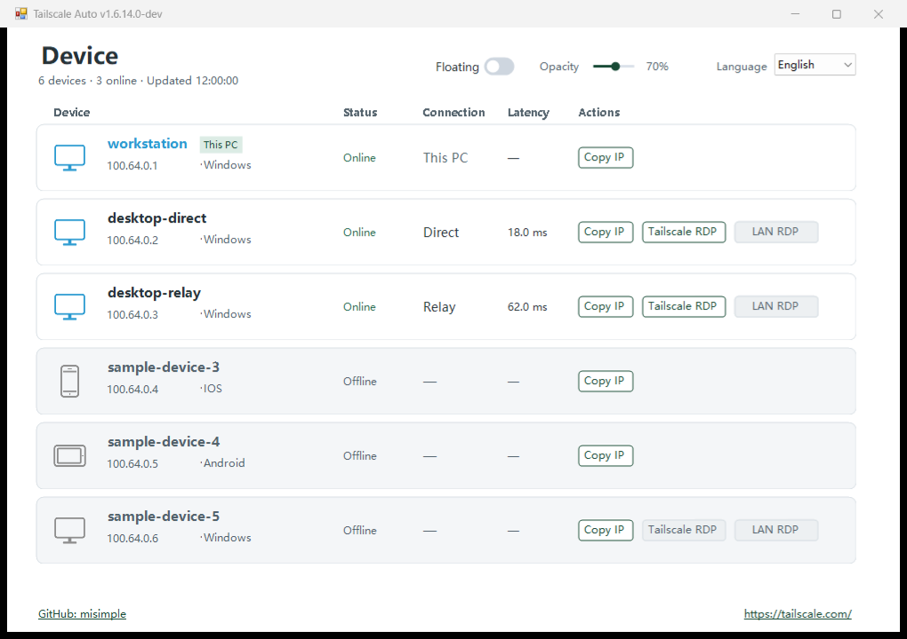

# Tailscale Auto

**See your Tailscale devices, connection paths, and remote desktop options in one Windows window.**

The Tailscale client provides the network, but checking which devices are online, whether a connection is direct or relayed, and which address to use for Remote Desktop can take several steps. Tailscale Auto brings those details together and refreshes the list every 15 seconds.

It shows the latest probe result and latency, lets you copy a Tailscale IP, and opens the built-in Windows Remote Desktop client for eligible Windows devices. When a physical local-network path and TCP 3389 are verified, a separate LAN RDP button becomes available. The LAN check is repeated before launch. The two RDP buttons use different target addresses.

## Features

- Device list with online status, direct or relay path, and latency from the existing Tailscale probe.
- Copy IP, local display aliases, Tailscale RDP, and conditionally available LAN RDP.
- Floating monitor, system tray, and single-instance behavior.
- English by default; switch to Simplified Chinese instantly. The choice is saved locally.

## Screenshot

The screenshot is captured from the actual 1.6.14.0 WinForms assembly using synthetic sample devices. The row shown as **Relay** uses a simulated DERP result; the UI groups DERP under Relay. The screenshot is a UI example, not an RDP test record.

## Download and quick start

Download the Windows ZIP from [Releases](https://github.com/misimple/TailscaleAuto/releases/tag/v1.6.14.0-dev), verify its SHA-256, extract it, and run `TailscaleAuto.exe`. Install and sign in to the official Tailscale client first. To close the app completely, choose **Exit** from the tray menu. Right-click a device to edit its local display alias.

The app writes `settings.json` beside the EXE. Keep that file private. Connection path and latency are the most recent probe results, not continuous measurements. Starting Remote Desktop does not guarantee login.

## Requirements

Windows 11 is the tested target; other Windows versions are not verified. The app requires the local Tailscale CLI, Windows `mstsc.exe`, and .NET Framework 4.x. LAN RDP additionally requires LAN connectivity through a verified physical route, Remote Desktop enabled on the target, and reachable TCP 3389. The EXE is not signed by a trusted publisher.

## Build from source

On Windows with the .NET Framework C# compiler, run `powershell -File .\build.ps1`, then `./bin/TailscaleAuto.Tests.exe --self-test`. Run `powershell -File .\tests\Build-And-Test.ps1` for the additional LAN integration checks. The included original generic device PNGs are embedded in the EXE. No NuGet dependencies are needed.

## Limitations and feedback

This is a development preview. The user reports successful Tailscale RDP and LAN RDP connections on multiple real Windows devices. Release-preparation automated and simulated integration checks passed. A separate, documented live acceptance run tied specifically to the 1.6.14.0-dev build is not available; the user report is not presented as that version-specific test. See the [acceptance status](docs/ACCEPTANCE_STATUS.md). Please report problems with a version number, Windows version, and reproduction steps; redact device names, Tailnet IPs, and logs, and never post `settings.json`.

## License and trademarks

Project-authored source code and generic device artwork are licensed under [MIT](LICENSE), Copyright (c) 2026 MiSimple. Tailscale Auto is an independent, unofficial companion and is not affiliated with or endorsed by Tailscale. Tailscale and other product names belong to their owners. The earlier brand PNGs are not included.

[简体中文说明](README.zh-CN.md)
