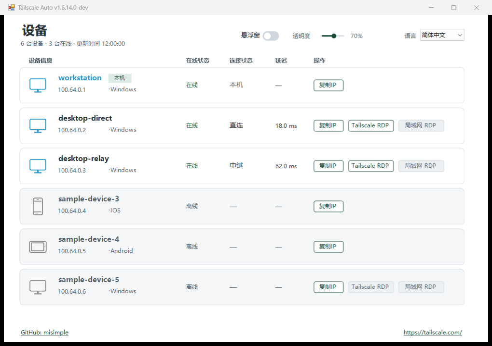

# Tailscale Auto

**在一个 Windows 窗口查看 Tailscale 设备、连接路径和远程桌面入口。**

日常使用 Tailscale 时，查看设备是否在线、连接是直连还是中继，以及远程桌面应使用哪个地址，往往需要分别检查。Tailscale Auto 把这些信息放在同一列表中，每 15 秒刷新一次。

程序显示最近一次探测的路径和延迟，支持复制 Tailscale IP，并为符合条件的 Windows 设备启动系统远程桌面。确认物理局域网直达且 TCP 3389 可用时，独立的局域网 RDP 按钮才会启用；点击前还会重新验证。两个 RDP 按钮使用不同的目标地址。

## 主要功能

- 设备在线状态、直连或中继路径，以及现有 Tailscale 探测得到的延迟。
- 复制 IP、本地显示别名、Tailscale RDP 和有条件启用的局域网 RDP。
- 悬浮窗、系统托盘及单实例运行。
- 默认英文，可即时切换简体中文；选择保存在本机。

## 界面截图

截图由实际 1.6.14.0 WinForms 程序集运行取得，设备均为合成测试数据。显示为“中继”的设备使用模拟 DERP 结果，界面将 DERP 归为“中继”。截图是界面示例，不作为 RDP 测试记录。

## 下载与快速开始

从 [Releases](https://github.com/misimple/TailscaleAuto/releases/tag/v1.6.14.0-dev) 下载 Windows ZIP、核对 SHA-256，解压并运行 `TailscaleAuto.exe`。请先安装并登录官方 Tailscale 客户端。彻底退出请使用托盘菜单的“退出程序”；右键设备可编辑本地显示别名。

程序在 EXE 旁写入 `settings.json`，请勿公开。连接路径和延迟是最近一次探测结果，不是持续测速。启动远程桌面客户端不保证登录成功。

## 运行条件

目前已测试的目标系统为 Windows 11，其他 Windows 版本尚未验证。需要本机 Tailscale CLI、Windows `mstsc.exe` 及 .NET Framework 4.x。局域网 RDP 还要求物理局域网路由连通、目标设备启用远程桌面服务，并且 TCP 3389 可达。EXE 尚无受信任代码签名。

## 从源码构建

在有 .NET Framework C# 编译器的 Windows 上运行 `powershell -File .\build.ps1`，再执行 `./bin/TailscaleAuto.Tests.exe --self-test`。额外的 LAN 集成测试运行 `powershell -File .\tests\Build-And-Test.ps1`。三枚原创通用设备 PNG 会嵌入 EXE，无需 NuGet 依赖。

## 限制与问题反馈

当前为开发预览版。用户反馈 Tailscale RDP 和局域网 RDP 均已在多台真实 Windows 设备上成功连接。发布准备阶段的自动化与模拟集成检查已通过。尚无单独留档、能明确对应 `1.6.14.0-dev` 构建的真实环境验收记录；用户反馈不等同于该版本的独立测试。详见[验收状态记录](docs/ACCEPTANCE_STATUS.md)。反馈问题时请提供版本、Windows 版本及复现步骤，并对设备名、Tailnet IP 和日志脱敏；不要上传 `settings.json`。

## 许可与商标

项目原创源码和通用设备图形采用 [MIT 许可证](LICENSE)，Copyright (c) 2026 MiSimple。Tailscale Auto 是独立开发的非官方辅助工具，不代表 Tailscale 官方，也未获其背书。相关产品名称归各权利人所有，旧版品牌 PNG 不包含在本公开目录中。

[English README](README.md)
